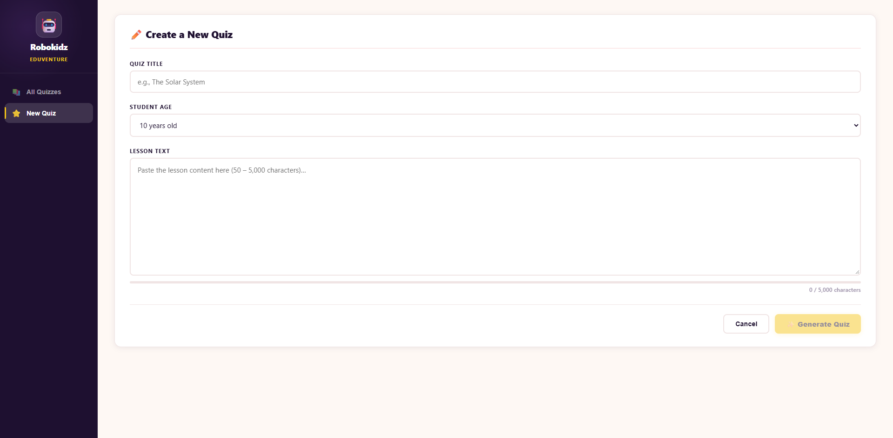
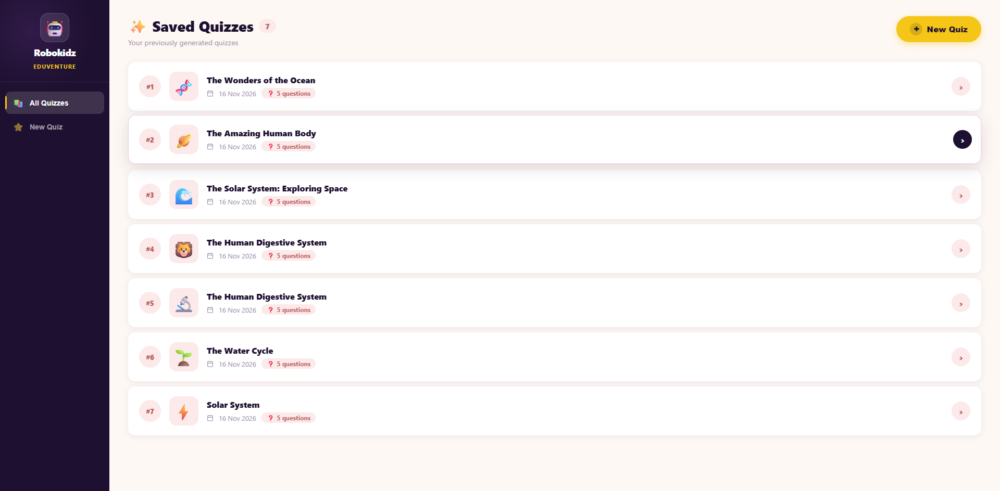
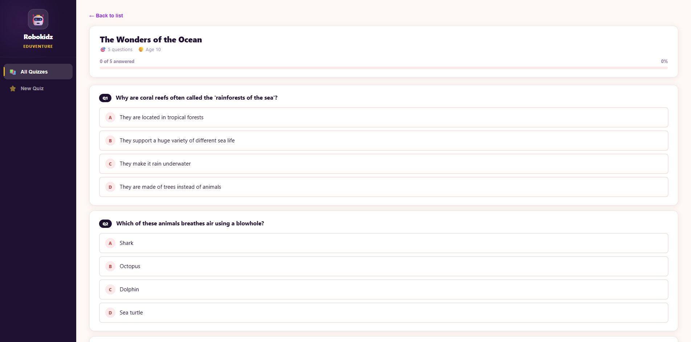

# Lesson Quiz Generator

A full-stack web app where a teacher pastes lesson text and gets a 5-question multiple-choice quiz generated by AI. Quizzes are saved to a database and can be taken interactively with a live score at the end.

Built as a take-home assignment for Robokidz.

---

## What the App Does

1. Teacher fills in a quiz title, student age, and pastes lesson text
2. Clicks **Generate Quiz** — the app sends the text to an AI (Groq LLM)
3. AI returns 5 multiple-choice questions with 4 options each
4. Quiz is saved to a SQLite database
5. Teacher/student can open any saved quiz, answer all questions, and see their score

---

## Screenshots

### Create a quiz
Title, student age and lesson text (50–5,000 characters, with a live counter). The Generate button stays disabled until the input is valid.



### Saved quizzes
All generated quizzes, newest first. Click one to open it.



### Take a quiz
Each question has 4 options. A progress bar tracks answered questions, and the score is shown at the end.



---

## Tech Stack

| Layer     | Technology |
|-----------|------------|
| Backend   | Python 3.11, FastAPI, SQLAlchemy 2, SQLite |
| AI / LLM  | Groq API (`qwen/qwen3.8-27b`) |
| Frontend  | React 18, Vite |
| Tests     | pytest + FastAPI TestClient |
| Bonus     | Docker Compose, GitHub Actions CI |

---

## Project Structure

```
lesson-quiz-generator/
├── backend/
│   ├── main.py          # FastAPI app — routes and startup
│   ├── models.py        # SQLAlchemy ORM models (3 tables)
│   ├── schemas.py       # Pydantic request/response validation
│   ├── llm_service.py   # Groq API integration + JSON validation
│   ├── database.py      # SQLite connection + session setup
│   ├── requirements.txt # Python dependencies
│   ├── .env.example     # Template for environment variables
│   └── tests/
│       ├── conftest.py  # pytest fixtures
│       └── test_quizzes.py  # 10 API tests
│
├── frontend/
│   ├── src/
│   │   ├── App.jsx            # Main layout + sidebar + state machine
│   │   ├── App.css            # All styles
│   │   ├── api.js             # Fetch calls to backend
│   │   └── components/
│   │       ├── QuizList.jsx   # List of saved quizzes
│   │       ├── QuizForm.jsx   # Create new quiz form
│   │       └── QuizView.jsx   # Take a quiz + see score
│   └── vite.config.js         # Dev proxy: /api → localhost:8000
│
├── docker-compose.yml   # Run everything with one command
└── .github/
    └── workflows/
        └── ci.yml       # GitHub Actions: runs tests on every push
```

---

## Running Locally (Step by Step)

### Prerequisites

Make sure you have these installed:
- **Python 3.11+** — https://www.python.org/downloads/
- **Node.js 20+** — https://nodejs.org/
- **Git** — https://git-scm.com/

---

### Step 1 — Clone the repository

```bash
git clone https://github.com/YOUR_USERNAME/lesson-quiz-generator.git
cd lesson-quiz-generator
```

---

### Step 2 — Set up environment variables

```bash
# Copy the example file
cp .env.example backend/.env
```

Now open `backend/.env` in any text editor and fill in:

```
MOCK_LLM=false
GROQ_API_KEY=your_groq_api_key_here
DATABASE_URL=sqlite:///./quizzes.db
```

**To get a free Groq API key:**
1. Go to https://console.groq.com
2. Sign up for free
3. Click **API Keys** → **Create API Key**
4. Copy the key and paste it in `backend/.env`

> **Don't have a key?** Set `MOCK_LLM=true` instead — the app will return a sample water-cycle quiz without calling any API. Everything still works.

---

### Step 3 — Set up and run the backend

Open a terminal and run:

```bash
cd backend

# Create a virtual environment
python -m venv .venv

# Activate it
# Windows:
.venv\Scripts\activate
# Mac/Linux:
source .venv/bin/activate

# Install dependencies
pip install -r requirements.txt

# Start the server
uvicorn main:app --reload
```

Backend is now running at **http://localhost:8000**

You can explore the API at **http://localhost:8000/docs** (Swagger UI — interactive API docs, no frontend needed)

---

### Step 4 — Set up and run the frontend

Open a **second terminal** (keep the backend running) and run:

```bash
cd frontend

# Install dependencies
npm install

# Start the dev server
npm run dev
```

Frontend is now running at **http://localhost:3000**

Open http://localhost:3000 in your browser — the app is ready to use.

---

### Step 5 — Run the tests

```bash
cd backend

# Windows:
$env:MOCK_LLM="true"; .venv\Scripts\python -m pytest tests/ -v

# Mac/Linux:
MOCK_LLM=true pytest tests/ -v
```

Expected output — all 10 tests pass:

```
tests/test_quizzes.py::test_create_quiz PASSED
tests/test_quizzes.py::test_list_quizzes_empty PASSED
tests/test_quizzes.py::test_list_quizzes_newest_first PASSED
tests/test_quizzes.py::test_pagination PASSED
tests/test_quizzes.py::test_get_quiz_not_found PASSED
tests/test_quizzes.py::test_text_too_short PASSED
tests/test_quizzes.py::test_text_too_long PASSED
tests/test_quizzes.py::test_age_out_of_range PASSED
tests/test_quizzes.py::test_full_detail_response PASSED
tests/test_quizzes.py::test_newest_first_ordering PASSED

10 passed in 1.2s
```

---

## Running with Docker (Alternative — One Command)

If you have **Docker Desktop** installed, you can run the entire app with a single command — no Python or Node setup needed.

```bash
# 1. Copy the env file
cp .env.example backend/.env
# Edit backend/.env and add your GROQ_API_KEY (or set MOCK_LLM=true)

# 2. Start everything
docker compose up --build
```

- Frontend → http://localhost:3000
- Backend → http://localhost:8000

To stop: press `Ctrl+C` then run `docker compose down`

---

## API Reference

| Method | Path | Description |
|--------|------|-------------|
| `POST` | `/api/quizzes` | Generate and save a new quiz |
| `GET`  | `/api/quizzes?page=1&size=10` | List all quizzes, newest first |
| `GET`  | `/api/quizzes/{id}` | Get one quiz with all questions and options |

### POST /api/quizzes — example request

```json
{
  "title": "The Water Cycle",
  "lesson_text": "Water evaporates from oceans and lakes when heated by the sun...",
  "age": 10
}
```

Validation rules:
- `lesson_text`: 50–5,000 characters
- `age`: 8–14

### GET /api/quizzes — example response

```json
{
  "items": [
    { "id": 1, "title": "The Water Cycle", "age": 10, "created_at": "2024-11-16T10:30:00" }
  ],
  "total": 1,
  "page": 1,
  "pages": 1
}
```

---

## Design Decisions

**Flat backend structure** — kept all files directly under `backend/` rather than adding a package layer. Simple to run and easy to navigate at this scale.

**LLM validation before saving** — the raw LLM response is parsed and validated before anything goes into the database. If the model returns malformed JSON or wrong number of questions, the request fails with a clear error rather than saving broken data.

**Mock mode** — `MOCK_LLM=true` returns a fixed quiz. All automated tests use this so CI runs fast and free without any API key.

**React state machine** — the whole frontend uses one `view` variable (`"list" | "create" | "quiz"`). No router library needed at this scale — keeps things simple and easy to follow.

**`is_correct` flag on options** — slightly denormalised but intentional. The frontend can render correct/wrong answers without extra string comparisons against the question's `correct_answer` field.

---

## What I Would Improve with More Time

- **User authentication** — right now anyone can create and read quizzes. A teacher login with JWT tokens would be the first real addition.
- **Score history** — save each attempt so teachers can track student progress over time.
- **LLM streaming** — stream the response token by token so users see questions appearing instead of waiting 10+ seconds.
- **Alembic migrations** — `create_all()` is fine locally but proper migrations would be needed before going to production with Postgres.
- **Frontend tests** — Vitest + Testing Library for the form and quiz-taking flow.

---

## AI Tools and Development Assistance

I developed the application myself and used AI tools as supporting resources during development. I mainly used **ChatGPT** and **Claude** to understand concepts, troubleshoot issues, review implementation approaches, and improve the overall quality of the application.

### ChatGPT
- Helped me understand concepts like async FastAPI endpoints and SQLAlchemy relationships while I was building
- Helped me understand how to integrate the Groq API and handle LLM-generated JSON responses
- Assisted with debugging errors, understanding validation logic, and improving error handling
- Helped me understand the application architecture and prepare technical documentation

### Claude
- Used as an additional resource to review code structure and implementation approaches
- Helped identify possible edge cases and areas for improvement
- Provided suggestions for cleaner code organization and better maintainability
- Helped me write and structure this README (setup steps, API reference, design decisions and screenshots)
- Helped me publish the project to GitHub, including Git setup and adding the app screenshots

### My Contribution

I was responsible for implementing and integrating the frontend and backend, connecting the database, configuring the LLM integration, testing the APIs, and ensuring the application worked according to the assignment requirements.

I used AI-generated explanations and suggestions as learning and development support. I reviewed the suggestions, understood the code, and made the necessary implementation decisions myself. AI tools supported my development process but did not replace my own work.
